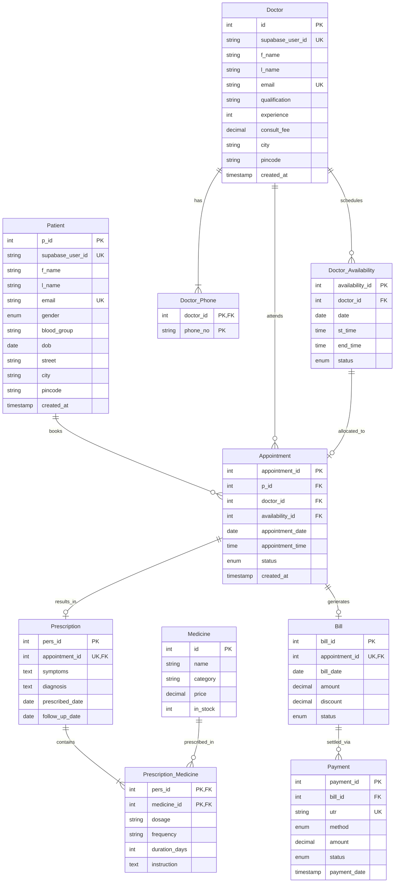

# SMART HEALTHCARE MANAGEMENT SYSTEM
## ENTITY-RELATIONSHIP (ER) DIAGRAM & RELATIONAL SCHEMA SPECIFICATION

---

### 1. MERMAID ER DIAGRAM

---

### 2. RELATIONAL NORMALIZATION (3NF) PROOF

1. **First Normal Form (1NF):**
   - Every column contains atomic (indivisible) values.
   - Doctor contact numbers are decomposed into the specialized `Doctor_Phone` relation with composite key `(doctor_id, phone_no)`.

2. **Second Normal Form (2NF):**
   - The schema is in 1NF.
   - No non-prime attribute is partially dependent on any candidate key.
   - In `Prescription_Medicine(pers_id, medicine_id)`, attributes such as `dosage`, `frequency`, `duration_days`, and `instruction` depend fully on the complete composite key `(pers_id, medicine_id)`.

3. **Third Normal Form (3NF):**
   - The schema is in 2NF.
   - No non-prime attribute exhibits transitive functional dependency on the primary key ($X \rightarrow Y \rightarrow Z$).
   - Derived attributes like patient age are calculated dynamically via stored function `calculate_patient_age(dob)` using `TIMESTAMPDIFF(YEAR, dob, CURDATE())` rather than being stored redundantly in the relation.

