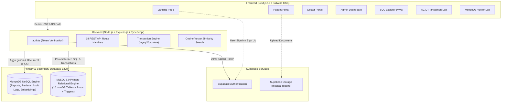

# SMART HEALTHCARE & DOCTOR APPOINTMENT MANAGEMENT SYSTEM
### A Full-Stack University DBMS Mini-Project (MySQL 8.0 • Express.js • Next.js • Supabase • MongoDB)

---

## 1. PROJECT OVERVIEW

The **Smart Healthcare & Doctor Appointment Management System** is an enterprise-grade clinical management, scheduling, prescription authoring, billing, and document analytics platform. 

It was engineered specifically to satisfy university DBMS evaluation standards with **MySQL 8.0 as the compulsory primary relational database**, alongside **Supabase** for Authentication & Storage, and **MongoDB** for dynamic diagnostic reports, reviews aggregation, audit logging, and natural language Vector Search.

### Key Capabilities:
- **10 Core Relational Tables** in 3NF normalized schema running on InnoDB.
- **ACID Transaction Lab** demonstrating true Atomicity (COMMIT / ROLLBACK), Consistency constraint checks, Isolation concurrency locks, and Durability persistence.
- **Advanced SQL Suite**: All JOIN varieties, Nested Subqueries, Correlated Subqueries, Common Table Expressions (CTE), and Recursive CTEs.
- **Database Logic**: 5 Stored Procedures, 3 User-Defined Functions, and 3 Active Triggers.
- **Role-Based Portals**: Dedicated, responsive workflows for **Patients**, **Doctors**, and **Hospital Administrators**.
- **MongoDB NoSQL Layer**: Schema-less medical reports, aggregation pipelines for ratings, TTL audit logs, and Cosine-Similarity semantic search.

---

## 2. SYSTEM ARCHITECTURE



---

## 3. RELATIONAL DATABASE SPECIFICATION (MYSQL)

The database schema is organized into 10 primary business tables plus supporting role mapping:

| Table # | Relation Name | Primary Key | Key Foreign Keys | Purpose |
| :---: | :--- | :--- | :--- | :--- |
| **1** | `Patient` | `p_id` | — | Patient demographics, contact info, and DOB |
| **2** | `Doctor` | `id` | — | Physician clinical credentials, experience, and consult fee |
| **3** | `Doctor_Phone` | `(doctor_id, phone_no)` | `doctor_id -> Doctor(id)` | 1NF resolution for multi-valued contact numbers |
| **4** | `Doctor_Availability`| `availability_id` | `doctor_id -> Doctor(id)` | Doctor scheduling calendar slots (`Available`, `Booked`) |
| **5** | `Appointment` | `appointment_id` | `p_id, doctor_id, availability_id` | Core consultation encounter entity |
| **6** | `Prescription` | `pers_id` | `appointment_id -> Appointment` | Symptoms, diagnosis, and follow-up advice |
| **7** | `Medicine` | `id` | — | Pharmacy drug inventory with stock checks |
| **8** | `Prescription_Medicine` | `(pers_id, medicine_id)` | `pers_id, medicine_id` | M:N mapping of drugs, dosages, and durations |
| **9** | `Bill` | `bill_id` | `appointment_id -> Appointment` | Invoices with gross amount, discounts, and status |
| **10** | `Payment` | `payment_id` | `bill_id -> Bill(bill_id)` | Financial settlements (UPI, Card, Cash) with unique UTR |
| **11** | `user_roles` | `id` | `mysql_ref_id` | Role mapping between Supabase Auth and MySQL profiles |

---

## 4. DEMO LOGIN CREDENTIALS

You can use the **1-Click Demo Buttons** on the homepage and login screen, or enter these credentials:

| Role | Email | Password | Pre-configured Profile |
| :--- | :--- | :--- | :--- |
| **Patient** | `patient@healthcare.com` | `demo123` | **Aarav Sharma** (O+ Blood, 34 yrs old) |
| **Doctor** | `doctor@healthcare.com` | `demo123` | **Dr. Rajesh Sen** (Cardiologist, 15 yrs exp) |
| **Admin** | `admin@healthcare.com` | `demo123` | **Hospital Administrator / DBA** |

---

## 5. INSTALLATION & SETUP INSTRUCTIONS

### Step 1: Clone or Navigate to Directory
```bash
cd C:\Users\Sanskar\DBMS_Project
```

### Step 2: Database Initialization (MySQL)
Make sure your MySQL server is running on port 3306. Execute the SQL scripts in this exact order:

```bash
# 1. Create Schema and Tables
mysql -u root -p < database/schema.sql

# 2. Compile Stored Procedures
mysql -u root -p < database/procedures.sql

# 3. Compile User-Defined Functions
mysql -u root -p < database/functions.sql

# 4. Compile Database Triggers
mysql -u root -p < database/triggers.sql

# 5. Populate Realistic Seed Data (15 Patients, 10 Doctors, 22 Appointments, etc.)
mysql -u root -p < database/seed.sql

# 6. (Optional) Configure Native Database Roles
mysql -u root -p < database/roles.sql
```

### Step 3: MongoDB Initialization (Optional / Local Fallback Active)
If MongoDB is installed locally:
```bash
mongosh < mongodb/collections.js
mongosh < mongodb/indexes.js
```
*Note: If MongoDB is not installed, the application automatically runs its built-in in-memory NoSQL engine so evaluation continues seamlessly without failure.*

### Step 4: Backend Setup & Start
```bash
cd C:\Users\Sanskar\DBMS_Project\backend
npm install
npm run build
npm start
```
*The backend API will be live at `http://localhost:5000`.*

### Step 5: Frontend Setup & Start
In a new terminal:
```bash
cd C:\Users\Sanskar\DBMS_Project\frontend
npm install
npm run dev
```
*Open your browser and navigate to `http://localhost:3000`.*

---

## 6. PROJECT DIRECTORY STRUCTURE

```
DBMS_Project/
├── backend/
│   ├── src/
│   │   ├── config/          # MySQL, MongoDB, and Supabase connection pools
│   │   ├── middleware/      # Supabase Auth verification & RBAC authorization
│   │   ├── routes/          # 18 Express REST API route handlers
│   │   ├── utils/           # SQL Explorer predefined queries & Cosine vector math
│   │   ├── app.ts           # Express application configuration
│   │   └── server.ts        # Server entrypoint with database health checks
│   ├── package.json
│   └── tsconfig.json
│
├── frontend/
│   ├── src/
│   │   ├── app/
│   │   │   ├── admin/       # Admin Dashboard, SQL Explorer & ACID Lab pages
│   │   │   ├── doctor/      # Doctor Portal (Encounters, Prescriptions, Slots)
│   │   │   ├── patient/     # Patient Portal (Booking, History, Bills, Reports)
│   │   │   ├── login/       # Multi-role authentication page
│   │   │   ├── register/    # Multi-role registration form
│   │   │   ├── layout.tsx   # Global navigation & theme layout
│   │   │   └── page.tsx     # Landing page with live metric counters
│   │   ├── components/      # Reusable UI widgets and Navbar
│   │   └── lib/             # API client methods and TypeScript interfaces
│   ├── package.json
│   └── tsconfig.json
│
├── database/
│   ├── schema.sql           # 10 Core Relational Tables + user_roles + Indexes
│   ├── procedures.sql       # 5 Stored Procedures (book_appointment, etc.)
│   ├── functions.sql        # 3 User-Defined Functions (calculate_patient_age, etc.)
│   ├── triggers.sql         # 3 Database Triggers (Stock deduction, etc.)
│   ├── seed.sql             # 15 Patients, 10 Doctors, 22 Appointments test data
│   ├── advanced_queries.sql # Joins, Nested, Correlated, CTE, Recursive CTE
│   └── roles.sql            # MySQL Native RBAC (CREATE ROLE, GRANT, REVOKE)
│
├── mongodb/
│   ├── collections.js       # JSON schema validated NoSQL collections
│   ├── indexes.js           # Secondary, text, and TTL indexes
│   └── vector-search.js     # Cosine-similarity semantic search engine
│
├── docs/
│   ├── README.md            # Master project documentation
│   ├── ER_DIAGRAM.md        # Relational schema and Mermaid ER diagram
│   ├── SQL_VIVA.md          # Comprehensive line-by-line viva explanation guide
│   └── PES_UNIVERSITY_EVALUATION_CHECKLIST.md  # 50-mark evaluation matrix
└── .env.example             # Environment variable templates
```

---

## 7. EVALUATION HIGHLIGHTS FOR EXAMINERS

1. **SQL Explorer (`/admin/sql-explorer`):**
   - Click any query (INNER JOIN, LEFT JOIN, Nested Subqueries, Correlated `EXISTS`, CTEs, Recursive CTE).
   - Click **"Execute SQL on MySQL"** to see live database results directly from MySQL 8.0, execution times in milliseconds, and line-by-line explanations.
2. **ACID Transaction Lab (`/admin/acid-lab`):**
   - Click **"1. Run Successful Transaction (COMMIT)"** to see live appointment and bill insertion.
   - Click **"2. Run Failed Transaction (ROLLBACK)"** to see atomic rollback where simulated failure causes MySQL to undo uncommitted inserts and guarantee 0 orphaned records remain.
   - Click **"Consistency"** to verify MySQL schema constraint rejection for negative stock.
   - Click **"Isolation"** to verify pessimistic row locking via `SELECT ... FOR UPDATE`.
3. **Doctor Prescriptions & Triggers (`/doctor`):**
   - Create a prescription for an appointment with multiple medicines.
   - Watch the MySQL trigger `trg_reduce_stock` automatically decrement stock in the `Medicine` table.
4. **Billing Settlement & Triggers (`/patient`):**
   - Settle a pending consultation bill using UPI or Card.
   - Watch the MySQL trigger `trg_update_bill_on_payment` automatically update the bill status to `Paid`.
5. **MongoDB NoSQL & Vector Search (`/admin/mongodb-explorer`):**
   - Enter natural language clinical symptoms (e.g., &quot;chest tightness&quot;) to observe Cosine-Similarity semantic search ranking diagnostic records.

